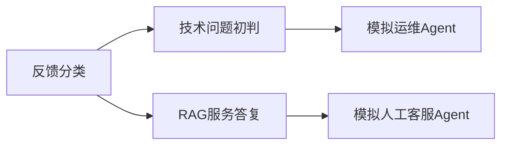

# 客服反馈分流：真实 Agent Flow 业务测试

> 文档类型：历史报告 · [当前阶段状态](project-status.md) · [文档导航](README.md)。保留当时的结果与失败；旧路径、默认值及本地产物不作为当前使用要求，也不保证随 clone 提供。

## 结论

已制作五节点客服 Flow，并进行四轮真实模型执行；第三、四轮均完成全部节点。**流程调度完成，但严格业务质量验收未通过**。最后一轮用时445.111秒，61次真实模型HTTP请求、61次工具调用与结果精确配对。没有人工代写或修正Agent生成的业务答复。

最后一轮30条反馈逐条分类正确，垃圾6、技术10、服务14；10条技术问题完整交给模拟运维，6条明确自动帮助无效的服务问题完整进入模拟人工队列。服务初答仍有未检索却登记查询、退款申请入口遗漏等问题；模拟人工也出现了虚构知识库缺口。不能把这些称为全部通过或可直接接入真实客服。

独立静态验收为360条检查断言通过、10条失败，退出1；这不是370个客户用例。10条失败涉及退款引用/入口、CF-018缺实际调用及证据，以及4个节点违反命令约束；另有下文列明的语义问题。原生引用校验器的6项受控变异探针通过，只证明校验器能识别相应错误，不是新增业务或模型成功用例。

## 场景与流程

虚构企业协作SaaS“星桥协作”每日接收大量反馈。固定业务日期2026-11-01，所有租户、编号、反馈与政策均为合成数据；实际测试在2026-11-01准备，2026-11-02恢复并完成。它是客服业务处理，不是让Agent开发一个客服应用。

垃圾保留分类记录，不流入运维或服务答复。服务Agent对普通咨询查专用知识库；客户明确表示此前自动帮助无效时，应只保留失败经历并转模拟人工。运维和人工均由独立Agent会话扮演，没有向真实人员发送消息、操作生产系统或批准退款。

当前Core按拓扑顺序逐个调度这些节点，**分支连线不代表真正并行**；本次顺序为分类、技术、服务、运维、人工。空分支也没有框架条件跳过能力；逐条筛选与转交依赖节点执行规则。不得以此次通过分流检查宣称并行或硬条件路由已实现。

## 用例、知识库与验收隔离

- [Flow配方](../src/agent_test/scripts/cases/customer_feedback_flow.json)：5个节点、4条边、业务背景及各节点输入输出规范。
- [反馈输入](../src/agent_test/scripts/cases/customer_feedback/feedback.json)：30条混排反馈，包含广告、灌水、注入、实际故障、退款、发票、套餐、席位、账号、导出及新功能建议。
- [知识库目录](../src/agent_test/scripts/cases/customer_feedback/knowledge/)：8份虚构政策文档，经真实向量召回、BM25、RRF和CrossEncoder重排检索。
- [操作者期望](../src/agent_test/scripts/cases/customer_feedback/expected.json)：运行前固定，SHA-256为`81f8c1d4c9842951a441b6e27c655b8f485597947afc5c39d525a230f7b1a08e`。没有复制到Agent工作区、提示词或RAG源。
- [夹具说明](../src/agent_test/scripts/cases/customer_feedback/README.md)：逐条政策事实、升级判断及不能冒充真实受理的边界。

每轮使用新工作区、独立状态、缓存和日志，执行目录只白名单复制反馈输入。知识库为工作区外的只读`support`源，默认DOC_DIR也指向同一专用库，防止遗漏source时检索用户知识。五个节点共享项目文件，各自使用独立会话和自动交接。所有原始用户工作区及旧Flow定义保持。

## 测试计划与实际步骤

1. 检查Git分支、状态和交接，保存原差异及既有数据哈希，沿用`codex/live-project-validation`。
2. 固定30条输入、8份政策及独立答案，覆盖6条必须转人工与8条不应误升级的服务反馈；包括“只看普通文章”“引用他人失败”“只是担心自动帮助无效”等反例。
3. 准备真实BGE ONNX向量模型与默认多语种CrossEncoder，固定revision、验证权重哈希，保持原检索阈值。准备阶段失败、恢复及加载预检不计为业务成功。
4. 在真实FlowService/ProjectService/SessionManager上导入模板、建立独立项目并启动；透传真实provider与注册工具，不注入模型回答或检索结果。
5. 独立检查逐ID分类、技术与运维交接、服务决策、实际RAG调用、逐条引用绑定、人工队列、提示词及交接保留、工具与结果配对、输入和知识库未改写。
6. 按发现修订业务配方，从另一个新目录复验；旧轮结果不删除，不把中断或质量失败追认为成功。
7. 完成独立语义复核及仓库回归，保留业务产物、真实检索证据与摘要；应用默认状态只新增未绑定模板及相应审计，没有运行用户项目。

## 四轮执行记录

| 轮次 | Flow状态 | 秒 | 模型回调 / HTTP请求 | 实际工具 | 主要结果 |
| --- | --- | ---: | ---: | ---: | --- |
| 01 | failed | 109.494 | 17 / 18 | 17 | 逐条分类正确，但自报汇总5/11/14与实际6/10/14不符；技术末尾TLS中断，下游阻断；技术不必要检索在模型未齐时失败 |
| 02 | failed | 46.779 | 8 / 9 | 8 | 分类汇总仍错误；技术遇provider限流，下游阻断 |
| 03 | completed，业务失败 | 693.131 | 70 / 88 | 73 | 全部节点完成，但引用编号虚构、跨查询串用原文、转人工后继续自动政策建议，另有命令约束违规 |
| 04 | completed，业务失败 | 445.111 | 61 / 61 | 61 | 原生来源引用及转人工回复改善，仍有下表中的质量问题；本轮所有模型调用一次成功，无重试请求 |

四轮合计156次模型回调、163次底层LLM调用、176次HTTP请求、159次真实工具调用。回调包装内的恢复会新增底层LLM调用，因此三种次数不同。每轮单独计时，不把四轮之和当作包含准备、等待和中断的总墙钟时间。

## 最后一轮业务结果与缺陷

| 项目 | 实际结果 |
| --- | --- |
| 三类分类 | 30/30逐条正确，ID无遗漏或重复；垃圾6、技术10、服务14 |
| 技术到模拟运维 | 10/10交接，优先级与固定期望一致；大面积503、疑似跨租户泄露、疑似文档丢失为P1；原因保留为假设，没有声称已修复 |
| 人工分流 | CF-004/009/010/015/021/025共6条全部转模拟人工，8条初答未误转；6条服务转交回复不再重复政策教程 |
| 服务初答 | 7/8条有本条实际检索；CF-018没有实际调用其登记的查询、无引用却仍给初答；CF-002退款申请入口与所需政策覆盖不足；不能算8/8通过 |
| 原生引用 | 已输出的9条来源文件名、偏移、短句可由对应反馈实际查询的结果证明；没有因原KB含某句就假定检索返回过该句 |
| 人工额外检索 | 服务Agent仍对CF-021/025做了额外政策检索，没有按规范直接交接；对应queries字段也未如实记录这些调用 |
| 人工内容 | CF-009模拟人工声称知识库缺少移除成员后的计费/降席口径，但SEA-02明文包含；属于虚构知识缺口 |
| 技术澄清 | 个别反馈仍遗漏精确时间/关联ID等问询，详见独立语义报告；不能把初判当完整定位 |

第四轮服务节点实际检索9次且均非空：7条初答各一次，加上CF-021/025两次不必要检索；CF-018的漏查不能归因于空结果或工具异常。运维节点另外检索3次（2次非空、1次空），配方未禁止运维检索，因此没有将其误报为约束违规。

另外，模型在业务JSON结构自查时使用了Python命令。即使只是本地读取业务JSON、没有生成应用源码或真实外发，仍违反本配方“不运行命令”的明确要求，独立验收将其保留为失败。提示词没有形成硬能力隔离；没有通过移除工具、放宽权限或改验收答案掩盖此问题。

第四轮4个节点共调用6次命令：5次Python业务结构自查、1次`true`。技术节点首条Python校验因语法错误退出1，随后修正为退出0；没有将错误命令算作成功。详细调用与逐条业务结论见独立报告。

## 已调整的配方与仍未解决的问题

分类文件改为只保存逐条items，数量由读取方确定，避免模型两处生成同一数字而不一致。逐ID类别及6/10/14的独立检查始终保留，没有降低分类标准。

服务引用从自定义文档/条款编号改为生产检索工具真实提供的`source/start/end/quote`。验收仍要求该条反馈实际执行了查询、同一返回段命中文件与偏移、原文逐字匹配，并由独立知识库映射核对政策。这修正了输出契约与工具来源元数据的不匹配，第三轮旧合同的失败没有撤销。

技术提示词加入保留现场、禁止清缓存/删除资料、明确模拟预备交接与通用澄清项；服务提示词要求自动帮助已失败时只准备转交。第四轮改善了这些表现，但引用覆盖检查、如实记录查询、人工知识边界及命令约束仍未全部遵循。**本轮交付是一次有失败发现的完整实测，不是生产质量认证。**

## 环境与证据边界

主模型为当前配置的`deepseek-v4.1-flash`，完整默认工具目录保留。独立进程设置输出上限8192 tokens、单次模型总时限240秒/空闲90秒，工具时限240秒、sandbox及测试项目full_access；模板本身环境、权限、模型留空，继承用户选择。没有修改用户`.env`、代理或Core/UI实现。

第三、四轮验收包装对无可执行返回的连接或限流异常最多5次真实调用、间隔15秒；模型及工具返回不被替换。第三轮有此恢复，第四轮没有触发。模型HTTP沿用默认客户端，没有将测试HTTP切到直连；Windows原生及后续WSL路径仅用于公开模型下载。原有网络路径的TLS/限流问题未宣称已修复。

真实模型为`Qdrant/bge-small-zh-v1.5` revision `46fbe35fd4374a00fee7de77dfddaeb6dd6a2c59`，ONNX SHA-256 `1294ea4b6331115a353d81f96b85e8c8d7fdcc284453d5b2fab5b016230aad38`；重排为`cross-encoder/mmarco-mMiniLMv2-L12-H384-v1` revision `1427fd652930e4ba29e8149678df786c240d8825`，权重 SHA-256 `5daeca2481a76b5976a2bdc32f0a78532b6716da4f8cd3ff59460ef8d2f359b4`。本地CPU FP32实际加载与推理预检通过，完整业务RAG证据来自Agent实际工具调用；未改召回/重排阈值。

脱敏证据在`.cache/reports/customer-feedback-flow-20261101-es280t1b/`：每轮case、summary、timeline、model-metrics、outputs、真实RAG结果及independent报告，另含模型哈希、原数据保护检查和回归摘要。独立验收脚本检查数是重复断言数，不是客户用例数。

场景包`customer-feedback-scenario.zip`含模板配方、工作区输入、8份知识、第四轮原始业务产物和本报告；不含期望答案、对话、审计、凭据或下载模型。独立只读终审未发现报告与证据不一致。所有本轮执行/下载/预检进程均已退出；私有测试状态与公开模型暂保留供后续定位，不启动Web或业务服务，也不自动重放。

完整非集成回归为**1725 passed、2 skipped、5 deselected（87.01秒）**；这证明既有工程回归仍通过，不能抵消上述真实业务失败。本轮没有新增生产依赖或环境变量。

## 应用内查看与复用

已在默认应用状态保存未绑定模板“客服反馈分流·技术运维与RAG服务”。未替用户选择项目或工作区，也未在默认状态运行它；旧Flow文件逐字节保持，新建模板及审计之外的既有用户数据未修改。前轮四Agent售后工单开发模板继续保留。

复用时创建自己的项目，将反馈JSON放入所选目录的`feedback.json`，通过已有`RAG_SOURCES`配置名为`support`的专用知识目录，并为真实本地向量/重排模型配置路径。**仅导入模板不会自动注册知识库或安装模型。**本轮命名源和模型路径只在独立测试进程生效，没有改写应用的全局知识库设置。禁止将`expected.json`复制给执行Agent；检查本报告所列缺陷后再决定如何继续演练。
